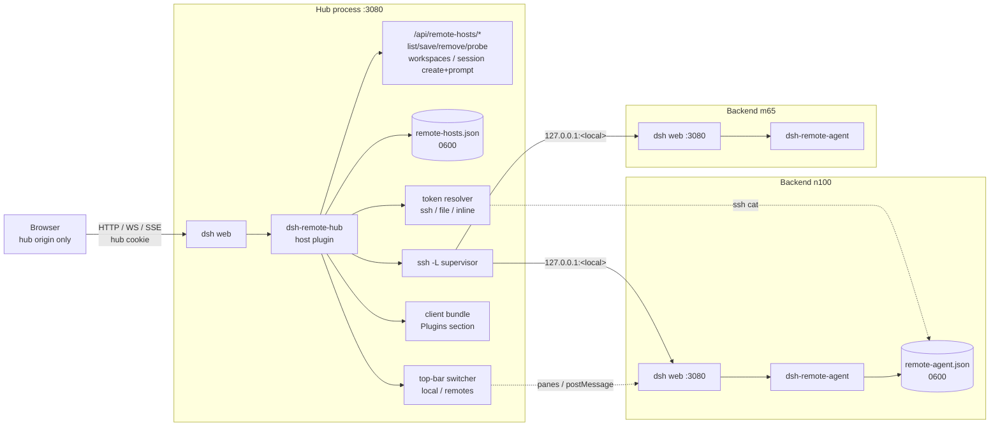

# Architecture

> Deployment: [docs/DEPLOY.zh.md](docs/DEPLOY.zh.md) · Chinese overview: [docs/ARCHITECTURE.zh.md](docs/ARCHITECTURE.zh.md)
> Robustness: [docs/ROBUSTNESS.zh.md](docs/ROBUSTNESS.zh.md) · Compatibility: [COMPATIBILITY.md](COMPATIBILITY.md)
> Changelog: [CHANGELOG.md](CHANGELOG.md)

## Goal

One `dsh web` process (the **hub**) is the only origin the browser talks to. Every remote
`dsh web` process (a **backend**) is exposed under the hub origin at `/remotes/<id>/`, so DSH's
same-origin fences (Host/Origin equality, `SameSite=Strict` cookies, no CORS) keep working
without changing remote code.

Non-goals: changing remote DSH behavior, replacing the remote UI, or making remote sessions
native local sessions. The hub is a proxy + supervisor + small admin surface.

## Topology

The backend half is the separate [dsh-remote-agent](https://github.com/yhuan416/dsh-remote-agent)
project; without it the hub can still use an inline token or a locally readable `tokenFile`.
The OpenCode integration is a separate project (`dsh-opencode-client`) and is not part of this
topology.

## Host plugin (`lib/index.js`)

Export shape: `name = 'remote-hub'`, `inject = ['webServer', 'connection', 'tools']`,
`apply(ctx, config)`, optional `Config` (schemastery).

| Part | Responsibility |
|---|---|
| **Store** | `$DSH_HOME/remote-hosts.json` (0600, atomic write): hosts, tombstones, version. Loaded at startup; admin routes mutate it. |
| **Tunnel supervisor** | Per ssh remote: allocate a local port, spawn `ssh -N -L`, wait for accept, backoff/reconnect, reallocate after repeated failures, kill on unload, persist tunnel records for cleanup. |
| **Token resolver** | Inline token, or `tokenFile` (`kind: ssh` reads the remote agent file over ssh; `kind: file` reads locally). Token never reaches the browser. |
| **Cookie exchange** | `GET /?token=...` against the remote, cache the remote cookie server-side, refresh when needed. Each remote has a unique local authority, so cookies cannot collide. |
| **HTTP proxy** | Register per-remote routes under `/remotes/<id>/`; strip the prefix, rewrite `Host`/`Origin` to the upstream authority, attach the remote cookie, stream responses, cap index rewriting at 4 MiB. |
| **Upgrade proxy** | Per-remote WebSocket route; pipe sockets (including `/api/remote.mux`). |
| **Entry / auth** | `/remotes/?token=<hub token>` relays to the hub's own token exchange, then 303s; otherwise the hub's cookie gates everything. |
| **Admin API** | `/api/remote-hosts/{list,save,remove,probe,workspaces}` plus `session/create` and `session/prompt` (remote RPC through tunnel + cookie). |
| **RPC helpers** | `remoteRpc()` speaks the DSH gateway envelope (`{type:'client-request', rpcId, method, payload:{args}}`) to a backend; used by workspace aggregation and session control. |
| **Switcher markup** | `switcherMarkup(hosts, currentId, options)` injects a top bar (and optional sidebar dropdown) into the hub's own index via `webserver/index-inject`; markup is self-contained JS, no build step. |
| **Tools** | `remote_sessions` and related host tools for agents. |

Lifecycle: everything long-lived is created through `ctx.effect(...)`; disposing the plugin
stops tunnels, health probes and HTTP routes.

## Client half (`lib/client.js`)

Declared through `dsh.client` (`platform: 'web'`) and loaded by the host as the
`window.__ModuleLoader__` bundle. It registers one `plugins.detail.section` (the **远端链路**
table) and, when framed, a `dsh-hub-open-session` message listener that forwards an open request
to `uiWorkspace.openSession()`. No build step, no external runtime deps.

The switcher itself is server-generated markup, not React, so it works on both the hub index
and proxied remote indexes (framed mode forwards `dsh-hub-open` / `dsh-hub-open-session`
messages through `postMessage`).

## Data flows

1. **Browser to remote**: hub cookie check → path rewrite → tunnel/upstream → response.
2. **Remote session list**: `session/list` RPC + optional ssh read of the remote workspace
   store; grouped into workspaces/orphans for the admin section.
3. **Remote session create**: `POST /api/remote-hosts/session/create` → `session/create`
   RPC with optional `cwd` → returns `{ sessionId, agentPreset }`.
4. **Remote prompt**: `POST /api/remote-hosts/session/prompt` → `session/prompt` RPC with
   `{ requestId, sessionId, mode, content, clientTimeZone }`.
5. **Open remote session in UI**: client dispatches `dsh-hub-open-session`; the switcher shows
   the backend pane and posts the same message into the framed page; the framed client calls
   `uiWorkspace.openSession(sessionId)`.

## Security model

- The hub cookie is the only browser credential; the hub is not an open proxy (owner-only).
- Remote tokens are read server-side and cached; never logged or sent to the browser.
- Cross-origin `Origin` requests are rejected; Host/Origin are rewritten for the upstream fence.
- Store is 0600; admin routes require the hub cookie; `/remotes/` without it is 401.
- SSH uses `BatchMode=yes`, `StrictHostKeyChecking=accept-new`; tunnel children die with the plugin.

## Deliberately not implemented

- **Native remote workspaces/sessions**: DSH's workspace registry and session list are local
  data sources, and `sidebar.workspaces` is a single-registrant slot. Merging remote sessions
  into the native tree needs an upstream workspace/session-provider seam, not HTML/iframe
  layering. Earlier embedded attempts were reverted.
- **LLM bridging**: proxying the model/agent stream loses DSH-native content; the hub keeps
  the remote UI intact and stays a transport.