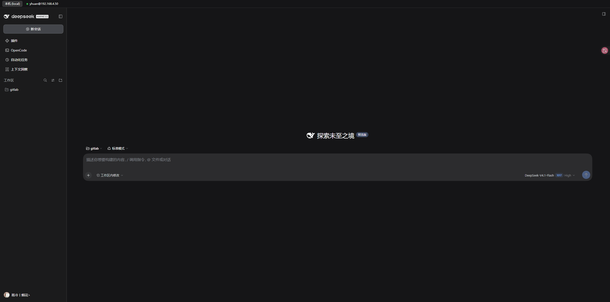
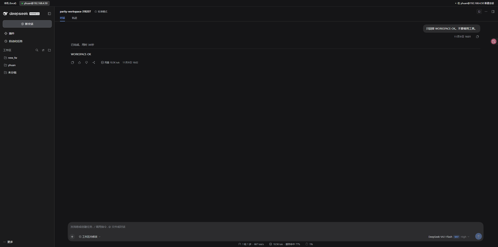
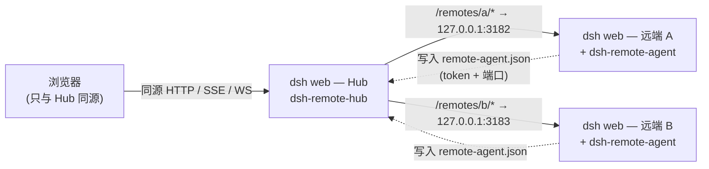

# dsh-remote-hub

<p align="center">
  <a href="https://github.com/yhuan416/dsh-remote-hub/releases"></a>
  <a href="LICENSE"></a>
  
  
  <a href="https://github.com/yhuan416/dsh-remote-hub/actions/workflows/check.yml"></a>
</p>

> [English](README.md) | 中文
>
> 部署步骤见 [docs/DEPLOY.zh.md](docs/DEPLOY.zh.md) ｜ 鲁棒性说明见 [docs/ROBUSTNESS.zh.md](docs/ROBUSTNESS.zh.md)
> 架构：[ARCHITECTURE.md](ARCHITECTURE.md) ｜ 中文架构总览：[docs/ARCHITECTURE.zh.md](docs/ARCHITECTURE.zh.md) ｜ 兼容性：[COMPATIBILITY.md](COMPATIBILITY.md)
> 变更记录：[CHANGELOG.md](CHANGELOG.md) ｜ 路线图：[ROADMAP.md](ROADMAP.md)（中文：[docs/ROADMAP.zh.md](docs/ROADMAP.zh.md)）
> 同族项目：[dsh-remote-agent](https://github.com/yhuan416/dsh-remote-agent) ｜ [dsh-opencode-client](https://github.com/yhuan416/dsh-opencode-client)

**一个浏览器标签页，管所有 dsh 后端。** Hub 就是一台 `dsh web`，它把每个已注册的远端后端反向代理到
`/remotes/<id>/` 下，因此浏览器始终只与 Hub 这一个 origin 通信——这正是 DSH 同源限制所要求的
（Host/Origin 一致、`SameSite=Strict` Cookie、全站无 CORS）。一个远端只是一个 Hub 能访问的 HTTP 基址：
手动 `ssh -L`、插件托管的隧道，或未来的 agent 通道；代理代码本身不变。

## 快速开始

```sh
# 1. 在 Hub 侧把插件装进 dsh profile
git clone https://github.com/yhuan416/dsh-remote-hub ~/.dsh/plugins/dsh-remote-hub
cd ~/.dsh/plugins/dsh-remote-hub && ./scripts/install.sh web

# 2. 让后端发布自己的 token：在远端装 dsh-remote-agent
#    https://github.com/yhuan416/dsh-remote-agent  →  ./scripts/install.sh web

# 3. 重启 Hub，然后打开 设置 → 插件 → dsh-remote-hub 添加远端
dsh web
```

之后顶栏会列出「本机」和所有远端；选中某个远端就在面板里打开它的后端，**＋ 在 <远端> 新建会话**
可以直接在指定工作区里建会话。完整步骤见[安装到 profile](#安装到-profile) 与
[docs/DEPLOY.zh.md](docs/DEPLOY.zh.md)；离线自检：`npm run check`。

## 目录

- [当前状态](#当前状态) · [截图](#截图) · [管理界面](#管理界面)
- [切换环境与新建远端会话](#切换环境与新建远端会话) · [存储](#存储) · [远端子代理](#远端子代理)
- [管理 API](#管理-apiowner-only同源-cookie) · [默认入口上的切换器](#默认入口上的切换器) · [入口点](#入口点)
- [工作原理](#工作原理) · [配置](#配置) · [传输方式](#传输方式) · [安装到 profile](#安装到-profile)
- [常见问题](#常见问题) · [生态](#生态) · [路线图](#路线图)

## 当前状态

**M1（v0.2.0）——多后端远端控制已可用**：代理、托管隧道、token 交换、顶栏切换、远端会话
create/prompt、cwd 选择。后续规划见 [docs/ROADMAP.zh.md](docs/ROADMAP.zh.md)（原生整合依赖
dsh 上游的 workspace/session 接缝）。

P0 已完成，并用真实的远端经 `ssh -L` 端到端验证：

| 检查项 | 结果 |
|---|---|
| 无 Hub Cookie 访问 `/remotes/` | 401 |
| `/remotes/` 兜底入口页 | 200 |
| `/remotes/<id>/` 远端首页 | 200，带自己的 `<base href="./">` |
| `/remotes/<id>/assets/*` | 200 |
| `/remotes/<id>/plugins/**` | 200 |
| `POST /remotes/<id>/api/<ns>/<method>` | 200（真实 gateway 信封） |
| `GET /remotes/<id>/plugins/events`（SSE） | 200 |
| `Upgrade /remotes/<id>/api/remote.mux` | 101 |
| 跨源 `Origin` | 403 |
| 未知远端 | 404 |
| 同时挂两个远端 | 均 200/101，各自的 boot 图互不干扰 |

每次健康探测还会解析后端的 `__DSH_BOOT__.release.version`；与 hub 自己的 dsh 版本不一致时会记日志，
并通过 `GET /api/remote-hosts/list` 与 `POST /api/remote-hosts/probe` 暴露
`remoteVersion` / `hubVersion` / `versionWarning`，同时显示在切换器的状态悬停提示里。

## 截图

Hub 顶栏的环境切换器——`本机 (local)` 加所有已注册远端；选中某个远端后，它的后端在面板里打开，
hub 页面本身不刷新：



在 hub 面板里打开的远端正端：这个会话是带 `workspace` 选项创建的，因此归入远端的 `new_fw`
工作区（左侧栏），而不是只占一个 cwd：



## 管理界面

远端管理已并入统一的 **Plugins** 页面：**设置 → 插件 → dsh-remote-hub**（该插件的详情页）。插件在那里贡献两块内容：

- 由导出的 `Config` 生成的**配置表单**：`upstreamTimeoutMs`、`probeIntervalMs`、`switcher.mode`、`switcher.dropdown`；
- **远端链路**区块（`plugins.detail.section`，由手写客户端 bundle `lib/client.js` 注册）：
  远端表格（状态点 / 名称 / 传输 / token 来源 / 延迟 / 最近错误）、每行 **打开 / 测试 / 删除**、
  添加表单（名称、ssh host、user、远端端口），以及 **远端工作区** 列表：聚合所有后端的工作区与会话
  （ssh 读 workspace store + `session/list` RPC；store 读不到时按 cwd 分组）。
  点会话会打开顶栏里的该后端，并向 iframe 发送 `{type:'dsh-hub-open-session', sessionId}`，
  远端页面的客户端半调用 `uiWorkspace.openSession()`（带重试与 ack；失败时退回后端首页）。

`/remotes/` 现在只是**兜底入口页**（纯链接，不再有管理台）；`/api/remote-hosts/*` 仍是插件页区块使用的 API。

## 切换环境与新建远端会话

多后端的主入口是**顶部环境切换栏**（本机 + 每个远端）。选中某个远端后，栏右侧出现
**＋ 在 <远端> 新建会话**：选择框里先列出该远端的工作区（选中后以 `workspace` 加入该工作区），
然后是已知目录、自定义路径或远端默认，并记住该远端上次使用的目录；调用
`POST /api/remote-hosts/session/create` 创建会话，再在该后端的 pane 中打开。

远端会话始终运行在后端自己的代理 UI 里，不是本地原生会话。之前的嵌入方案（侧边栏镜像 /
iframe 页面 / 新会话 hero 行）已刻意移除——它们在没有原生数据接缝的情况下叠加 UI；
详见 [ARCHITECTURE.md](ARCHITECTURE.md)。

## 存储

运行期配置存放在 `$DSH_HOME/remote-hosts.json`（0600，原子写）：

```
{
  "version": 1,
  "removed": ["old-id"],     // 墓碑：配置里的种子被删除后不会复活
  "hosts": [ { "id": "...", "label": "...", "ssh": {...}, "tokenFile": {...} } ]
}
```

- 首次启动：把 `cordis.patch.yml` 里的 `remotes` 数组导入 store；
- 之后启动：store 是权威来源；配置里新增的 id 会被导入，除非被墓碑标记；
- 在 UI 里删除会写入墓碑，因此配置里的种子不会重新出现。

## 远端子代理

Hub 可以把任务交给远端 dsh 后端，在它自己的环境（文件、工具、模型）里跑，只把最终答案带回
当前会话：

- **`remote_subagent` 工具**：只要注册了远端就可用，参数
  `{ host?, task, workspace?, cwd?, session?, timeoutMs? }`。新建（或续用）远端会话、下发任务、等远端
  turn 结束，返回**完整**的最终文本（从 durable transcript 读取）+ 远端会话 id。不依赖
  OpenCode 配置。`workspace`（工作区 id 或其绝对路径）让新会话**加入**该远端工作区，而不是只占一个
  `cwd`；与 `cwd` 互斥。路径会通过 ssh 读取后端的 workspace store 解析，所以只有 upstream、没有 ssh
  的远端需要直接给 id。用 `cwd` 建的会话目录正确，但不会写进 workspace store（在 hub 的工作区聚合里
  表现为 orphan）。
- **原生 dsh 子代理 provider**：每个远端一个 `remote-dsh-<id>`。在 profile 里加一行工具配置
  把它暴露给 agent（新增远端后需重启）：

```yaml
- insert:
    - id: tool-remote-n100
      name: "@deepseek-ai/dsh-tool-subagent"
      config:
        provider: remote-dsh-n100
        maxDepth: provider-managed
        toolName: remote_subagent_n100
```

原生 provider 会把父会话的绝对 cwd 传给远端；该路径必须在后端存在（两边目录布局一致时可直接用）。
在外部 provider 接缝允许的范围内，尽量对齐本地子代理：

- `agentPreset` 透传给 `session/create`
- `agentOptions.provider/model/reasoningEffort` 通过 `session/selectModel` 应用（模型必须存在于远端；
  `maxTokens` 会被拒绝，因为远端选择 API 不支持）
- `outputSchema` 用 prompt 约束 + 本地校验，返回 `structured`
- `label` 会把远端会话重命名为 `dsh subagent: <label>`
- abort/dispose 会取消远端 turn

做不到：可续用子会话、把远端工具/事件实时流进父会话、共享父上下文、继承 depth 限制、
原生 subagent catalog 卡片——这些需要本地 Agent 或上游的 remote-session provider。
不想加原生行，就用 `remote_subagent` 工具并显式传 `host`/`cwd`。

## 管理 API（owner-only，同源 Cookie）

| 路由 | 方法 | 请求体 | 返回 |
|---|---|---|---|
| /api/remote-hosts/list | GET | — | 脱敏后的远端列表 + 隧道/token 状态 |
| /api/remote-hosts/save | POST | label, transport, ssh{host,user,port}, remotePort, localPort, upstream, tokenMode, token, tokenPath | { ok, id } |
| /api/remote-hosts/remove | POST | { id } | { ok } |
| /api/remote-hosts/workspaces | GET | — | 每个远端的 workspaces[{id,title,path,sessions[]}] + orphans；ssh 读后端 workspace store，直连按 cwd 分组 |
| /api/remote-hosts/probe | POST | { id } | { ok, result: { status, latencyMs, tokenResolved, hasCookie } } |
| /api/remote-hosts/session/create | POST | { id, cwd? } | { ok, sessionId, agentPreset }（转发远端 session/create） |
| /api/remote-hosts/session/prompt | POST | { id, sessionId, text, mode? } | { ok, accepted }（转发远端 session/prompt） |

这些路由通过 `ctx.connection.fetch.register` 注册，框架会强制 owner Peer 与浏览器信任围栏。

## 默认入口上的切换器

插件通过官方 `webserver/index-inject` 钩子（`kind: "html"`，body 位置）向 Hub 自己的首页注入一个切换器：

- 默认 `bar` 模式：顶部**常驻切换栏**，列出「本机」+ 每个远端。选中远端后，栏下方用 iframe
  显示该后端（只挂载一次、之后保持）；点「本机」只是隐藏 iframe，露出**同一个**本地页面——
  **不会重载**。切换栏通过 `body{padding-top:34px}` 占位，应用排版不跳动。
- 配色使用应用自己的主题变量（`--dsw-alias-bg-base`、`--dsw-alias-label-primary`、
  `--dsw-alias-border-l2`、`--dsw-alias-interactive-bg-*`），因此跟随明暗主题，不再出现夜间模式下的白块。
- 每个远端标签前有**状态点**，每 5 秒从 `/api/remote-hosts/list` 轮询：
  绿=online、黄=pending/启动中、红=offline、灰=unknown；悬停可看到 state / 隧道状态 / 最近错误。
- 顶栏常驻后，侧边栏「新会话」下方的下拉框**默认关闭**；需要时用 `switcher.dropdown: true` 打开。
- 同时会插入侧边栏「新会话」按钮**正下方**的下拉框（作为第二个入口）
  （通过 CSS Module 类名后缀 `_newSession` 定位），并用 MutationObserver 在 React 重渲染后
  重新插回；侧边栏折叠时自动隐藏。找不到锚点时会退化为悬浮 pill。
- 配置：

```
  config:
    switcher:
      mode: sidebar        # sidebar（默认）| floating
      corner: bottom-right # 仅 floating 模式生效
      offsetX: 14
      offsetY: 14
```
- 选择某个远端会打开**全屏覆盖层**，用 iframe 承载该后端，因此切换**不会重载当前页面**；
  iframe 一旦打开就保持挂载，来回切换是瞬间的。「本机 / 关闭 / Esc」收起覆盖层；
  覆盖层里的远端页面通过 postMessage 通知父页面切换，而不是跳转顶层窗口；
- 内容：列出「本机」+ 每个远端（当前项高亮）以及「管理远端…」；链接带 `target="_top"`，
  因此从启动器 iframe 里点也能切到外层窗口；
- 它只出现在 Hub **已认证**的首页响应里——401 页面和被代理的远端页面都不会有，链接里也不含 token
  （靠已有的 Hub Cookie 授权）；
- 启动器页自带「← 本机」返回本地 UI。

顶栏是宿主插件注入的纯 HTML；远端管理用一段手写的客户端 bundle（`lib/client.js`，通过 `dsh.client` 声明），
只做 Plugins 页区块注册——两边都不需要构建步骤。

## 入口点

- `/remotes/?token=<hub launch token>` —— 一次性入口：插件把 token 转交给 Hub 自己的 `/?token=`
  交换流程、种下 Hub Cookie，然后 303 到干净的 `/remotes/`。
  注意 token URL 与后续访问要使用**同一个主机名**（127.0.0.1 和 localhost 是两个 Cookie 域）。
- `/remotes/` —— 兜底入口页（纯链接）；管理已迁到 Plugins 页。
- `/remotes/<id>/` —— 某个远端自己的 SPA（被代理）。
- `/remotes/_status` —— JSON 诊断：每个远端的 `hasToken / hasCookie / lastError`。

## 工作原理



1. Hub 像普通 dsh 页面一样认证浏览器（自己的 token/Cookie）。
2. 对每个远端，插件在**服务端**保存一份 Cookie：首次使用时由插件自己完成远端的
   `GET /?token=<token>` 交换并缓存。浏览器永远看不到远端 token 和远端 Cookie。
3. 转发请求时：
   - 剥掉路径前缀（`/remotes/n100/api/x` → `/api/x`）；
   - 把 `Host` 与 `Origin` 一起改写为上游 authority（如 `127.0.0.1:3182`），
     远端的 Host/Origin 围栏会把它当作 loopback 放行；
   - 带上缓存的服务端 Cookie。
4. 因为每个远端在 Hub 上独占一个本地端口，改写后的 authority 天然唯一，上游铸出的 Cookie
   不会互相覆盖——不需要重命名 Cookie。
5. WebSocket 升级按远端逐条注册（exact 路由），然后 socket 对 socket 透传。

## 配置

```
- insert:
    - id: remote-hub
      name: dsh-remote-hub
      config:
        remotes:
          - id: n100                       # 仅 [A-Za-z0-9_-]+，唯一且稳定
            label: yhuan@192.168.4.50
            upstream: http://127.0.0.1:3182 # Hub 能访问到的地址
            token: <远端 dsh 的 launch token> # 方案 A：内联（远端每次重启都会变）

          - id: n100
            upstream: http://127.0.0.1:3182
            tokenFile:                       # 方案 B：自动读取 token
              kind: ssh                      #   ssh | file
              host: 192.168.4.50
              user: yhuan
              path: ~/.dsh/remote-agent.json #   由后端的 dsh-remote-agent 写入

          - id: local2
            upstream: http://127.0.0.1:3183
            tokenFile: /home/yhuan/.dsh/remote-agent.json   # 方案 B，同机读文件
```

token 是凭据：profile 文件保持 0600，并且不要写进日志。

可调参数（与 remotes 同一层配置）：

```yaml
config:
  upstreamTimeoutMs: 30000   # 响应头超时；超时返回 504
  probeIntervalMs: 30000     # 周期健康探测（GET /）；0 关闭
```

## 传输方式

每个远端二选一：

```
# A. Hub 已经能访问到它（手动 ssh -L、局域网、wg 等）
- id: local2
  upstream: http://127.0.0.1:3183

# B. 由插件自己管理隧道
- id: n100
  ssh: { host: 192.168.4.50, user: yhuan }   # 可选：port、identityFile、proxyJump
  remotePort: 3080                            # 远端 dsh 端口，默认 3080
  # localPort: 32000                          # 可选；默认 32000 + 序号（稳定），
                                              # 被占用时退回随机空闲端口
```

托管隧道的行为：

- 启动 `ssh -N -L 127.0.0.1:<local>:127.0.0.1:<remotePort>`，参数包含
  `BatchMode=yes ConnectTimeout=8 ExitOnForwardFailure=yes ServerAliveInterval=15 StrictHostKeyChecking=accept-new`；
- 最多等 8 秒确认本地端口可连接，然后标记 `tunnel.state=up`；
- 进程退出后按指数退避重连（1s → 30s）；连续失败 3 次会重新分配本地端口（除非显式配置了 `localPort`）；
- 插件卸载时杀掉子进程，不留下孤儿 `ssh`，也不泄漏监听端口；
- 隧道不可用时，`/remotes/<id>/...` 返回 502，并带上最后一次 ssh 错误。

## 手动传输（第一步）

```
# 在远端
dsh web --no-open --port 3080          # 会打印 http://127.0.0.1:3080/?token=...

# 在 Hub 上
ssh -N -L 3182:127.0.0.1:3080 yhuan@192.168.4.50

# 再把远端 token 填进 config.remotes[].token
```

## 安装到 profile

```
git clone https://github.com/yhuan416/dsh-remote-hub ~/.dsh/plugins/dsh-remote-hub
cd ~/.dsh/plugins/dsh-remote-hub
./scripts/install.sh web
```

脚本会：软链包 → 在 profile 的 `package.json` 里登记为 **dependency** 并加入 **bundle 选择**
（Plugins 页只列 dependency，纯 patch 行不会出现）→ 如存在旧的手工 patch 行则删除 →
改动前自动备份。之后必须重启 `dsh web`（bundle 选择在启动期组合）。

管理入口：**设置 → 插件 → 已安装插件 → dsh-remote-hub**。

## 常见问题

| 现象 | 排查 |
|---|---|
| 远端标签一直是灰/红 | 看 `GET /api/remote-hosts/list` 的 `state`、`tunnel.state`、`lastError`。`ssh -L` 断了会显示 `offline`；监视线程会退避重试，连续失败 3 次且端口未固定时自动换端口。 |
| `/remotes/<id>/` 返回 401 | Hub 的 Cookie 交换失败。确认后端写好了 `~/.dsh/remote-agent.json`（已装 dsh-remote-agent 并重启），且 ssh 目标能读到它。 |
| 远端返回 403 | 撞上了 Host/Origin 校验。只能通过 Hub 的 origin 访问；其它站点直接带 `Origin` 请求会被刻意拒绝。 |
| 新建会话报 `workspace path not found` | 该路径在后端不是工作区，报错里会列出已知路径；远端没有 ssh 端点读不到 workspace store 时，请直接传工作区 id（uuid）。 |
| 某个远端出现 `versionWarning` | Hub 与远端的 dsh 版本不一致。不致命，见 [COMPATIBILITY.md](COMPATIBILITY.md)。 |
| 改完代码 `npm run check` 失败 | 两段内联浏览器脚本是字符串拼接的，`check.mjs` / `check-launcher.mjs` 会解析它们，专门用来抓「转义坏了导致顶栏空白」这类问题。 |

## 生态

| 项目 | 职责 |
|---|---|
| **dsh-remote-hub**（本仓库） | Hub 侧：反向代理、隧道、token 交换、顶栏切换、远端子代理 provider。 |
| [dsh-remote-agent](https://github.com/yhuan416/dsh-remote-agent) | 远端侧：运行在每个后端 `dsh web` 里，发布 launch token + 身份，Hub 无需手工拷 token。 |
| [dsh-opencode-client](https://github.com/yhuan416/dsh-opencode-client) | 独立插件：把 OpenCode 变成 dsh 的客户端 / 子代理后端（会话、委派、目录）。 |

## 路线图

- ✅ 反向代理（HTTP / WebSocket / SSE）、鉴权门、Cookie 隔离
- ✅ 管理台 + 持久化 store + owner-only API（list / save / remove / probe）
- ✅ 每个远端的 ssh 隧道托管（端口分配、退避重连、清理）
- ✅ 后端 agent 插件：发布 `~/.dsh/remote-agent.json`，Hub 经 ssh 读取 token
- ✅ 默认入口的侧边栏切换器
- ⬜ 传输抽象：`ssh-reverse` / WebSocket 拨号（当 Hub 可被拨入时）
- ✅ 客户端半：Plugins 页「远端链路」区块 + 生成的配置表单
- ⬜ 跨后端的统一工作区/会话列表