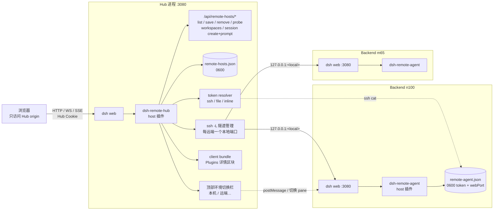

# 架构总览（中文）

> 部署步骤见 [DEPLOY.zh.md](DEPLOY.zh.md) ｜ 鲁棒性说明见 [ROBUSTNESS.zh.md](ROBUSTNESS.zh.md)
> 英文版组件说明见仓库根目录 [ARCHITECTURE.md](../ARCHITECTURE.md)

## 1. 目标

一台 **Hub dsh web** 作为浏览器唯一访问的 origin；每台 **Backend dsh web** 通过
`/remotes/<id>/` 挂在 Hub 同源下。浏览器只与 Hub 通信，DSH 的同源限制（Host/Origin
一致、`SameSite=Strict` Cookie、无 CORS）因此不需要改远端。

Hub 负责代理、隧道、token 与多后端切换；Backend 只需要正常运行并（可选）装一个很小的
agent 插件。

## 2. 架构图

图里没有画出的可选部分：OpenCode 集成是**另一个独立插件**
（`dsh-opencode-client`），对端是 `opencode serve`，与 dsh 远端这组互不依赖。

## 3. 组件职责

| 组件 | 位置 | 职责 |
|---|---|---|
| `dsh-remote-hub` host 插件 | Hub | 反向代理、隧道监管、token/cookie、管理 API、会话 create/prompt、顶栏切换器 |
| Hub client bundle | Hub 浏览器 | Plugins 详情页「远端链路」区块；iframe 内 `dsh-hub-open-session` 消息桥 |
| 顶部环境切换栏 | Hub 页面注入 | 本机 / 每个远端；选中远端后可「＋ 在 … 新建会话」（带 cwd 选择） |
| `dsh-remote-agent` host 插件 | 每个 Backend | 把当前进程的 launch token/身份写入 `remote-agent.json`（可选，但推荐） |
| `remote-hosts.json` | Hub `$DSH_HOME` | 运行期远端清单（0600，原子写） |
| `remote-agent.json` | Backend `$DSH_HOME` | token + webPort + 身份（0600，60s 心跳，退出删除） |

## 4. 关键数据流

1. **页面加载**：浏览器 → Hub（Hub Cookie）→ `/remotes/<id>/` → 隧道/直连 → 远端 SPA。
2. **token 获取**：Hub 需要时通过 ssh 读取 Backend 的 `remote-agent.json`，用 token 向远端
   换取 Cookie 并缓存在 Hub 进程内；token 与远端 Cookie 都不下发浏览器。
3. **会话列表**：`session/list` RPC +（可选）ssh 读远端 workspace store，聚合到插件页。
4. **新建会话**：`POST /api/remote-hosts/session/create { id, cwd? }` → 隧道 → 远端
   `session/create` → 返回 `sessionId`，Hub 打开对应后端 pane。
5. **发 prompt**：`POST /api/remote-hosts/session/prompt` → 远端 `session/prompt`。
6. **打开已有会话**：Hub client 派发 `dsh-hub-open-session`；切换器显示目标 pane，并向
   iframe 发消息，远端页面的客户端半调用 `uiWorkspace.openSession()`。

## 5. 同源与安全

- Hub 是单用户/单 owner；`/remotes/**` 全部经过 Hub Cookie 鉴权。
- 跨源 `Origin` 拒绝；代理把 Host/Origin 改写成上游 loopback authority，满足远端的同源围栏。
- 每个远端使用独立本地端口，远端 Cookie 天然隔离，不需要改名。
- token/远端 Cookie 只在 Hub 进程内；两个 JSON 文件都是 0600。
- ssh 使用 `BatchMode=yes`、`StrictHostKeyChecking=accept-new`；插件卸载时隧道子进程被清理。

## 6. 失败模式（简）

| 失败 | 表现 | 恢复 |
|---|---|---|
| ssh 隧道断 | `/remotes/<id>/` 502，顶栏状态点 offline | supervisor 指数退避重连；端口被占则重新分配 |
| 远端 dsh 未启动 | probe 失败、状态 offline | 启动 Backend；agent 文件缺失即表示未运行 |
| token 文件缺失/过期 | auth-required / `tokenResolved:false` | 确认 agent 插件加载并重启 Backend |
| 远端 dsh 升级导致 API 变化 | session 列表空 / API 4xx | 按 [COMPATIBILITY.md](../COMPATIBILITY.md) 更新插件适配 |

## 7. 已知边界

- 每个 Backend 是完整 SPA（pane/iframe 承载），不做跨后端的原生会话/工作区合并；
- 原生合并需要 DSH 上游 workspace/session provider 接缝；不要用 DOM/iframe 叠加；
- 同一 Hub origin 下 iframe 共享 localStorage（主题、布局偏好可能互相影响）。
