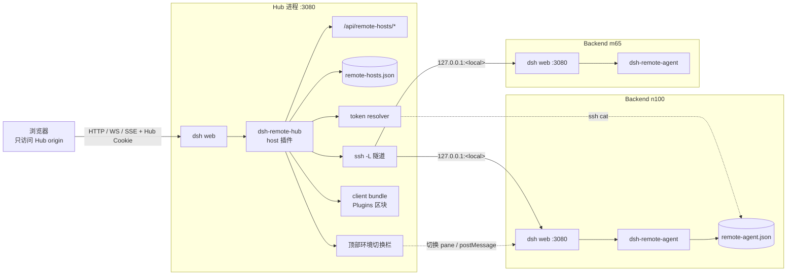

# 部署指南（中文）

> 适用版本：dsh 0.2.1-rc.2 及以上 ｜ Node 22.19+ ｜ 2026-11
> 架构细节：[ARCHITECTURE.zh.md](ARCHITECTURE.zh.md) ｜ 兼容性：[../COMPATIBILITY.md](../COMPATIBILITY.md)

本指南把两件事部署起来：

- **Hub**：你日常打开的那台 dsh web。浏览器只连它。装 `dsh-remote-hub`。
- **Backend**：每台要被管理的 dsh web。装一个很小的 `dsh-remote-agent`（可选但推荐）。

## 架构总览



要点：

- 浏览器只连 Hub 一个 origin；远端 SPA 通过 `/remotes/<id>/` 代理；
- Hub 用 `ssh -L` 连每个 Backend（或使用已打通的直连地址）；
- Hub 通过 ssh 读 Backend 的 `remote-agent.json` 取 token，token 与远端 Cookie 都不进浏览器；
- 每个 Backend 的 dsh web 保持 loopback，无需对外开放。

## 0. 前提

| 项 | 要求 |
|---|---|
| dsh | 0.2.1-rc.2+（Hub 与每个 Backend 版本可以不同） |
| Node | 22.19+（Hub 与 Backend 各自满足即可） |
| Hub → Backend | **能 SSH 登录**（托管隧道与读取 token 都用它）；或你自己先把 upstream 打通 |
| 端口 | 所有 dsh web 保持默认只监听 `127.0.0.1`，**不需要**对外开放 |

## 1. 部署 Backend（每台都做）

### 1.1 安装 agent 插件

```
git clone https://github.com/yhuan416/dsh-remote-agent ~/.dsh/plugins/dsh-remote-agent
cd ~/.dsh/plugins/dsh-remote-agent
./scripts/install.sh web
```

脚本会：软链进 `~/.dsh/profiles/node_modules` 与 `~/.dsh/profiles/web/node_modules`；
把包登记为 profile **dependency** 并选为 **bundle**（这样才会出现在 设置 → 插件 里）；
如果存在旧版手工追加的 `remote-agent` patch 行，会一并删除。改动前都会备份。

如果不想用脚本，手动等价操作见
[dsh-remote-agent README](https://github.com/yhuan416/dsh-remote-agent#install-manual)。

> 从 0.2.0 起推荐 bundle 安装。旧的"只写 patch 行"方式仍能运行，但插件页看不到它，
> 且升级时容易出现 patch 与 bundle 重复的 row。

### 1.2 重启 Backend 的 dsh web

```
# 前台：Ctrl-C 后重新执行
dsh web --no-open --port 3080

# 或者 systemd 用户服务
systemctl --user restart dsh-web
```

### 1.3 验证

```
cat ~/.dsh/remote-agent.json
# 应包含 "token"、"hostname"、"webPort"、"updatedAt"（每分钟刷新）
```

同时在 **设置 → 插件** 里应能看到 `dsh-remote-agent` 这个 bundle（bundle 安装方式）。
文件不存在或 token 过期，通常是插件没加载（检查 bundle 选择 / 是否重启）。

## 2. 部署 Hub

### 2.1 安装 hub 插件

```
git clone https://github.com/yhuan416/dsh-remote-hub ~/.dsh/plugins/dsh-remote-hub
cd ~/.dsh/plugins/dsh-remote-hub
./scripts/install.sh web

脚本做三件事：软链包；在 `~/.dsh/profiles/web/package.json` 里加 **dependency** 和 **bundle 选择**；
删除旧版本留下的手工 `remote-hub` patch 行（改动前都会备份）。

> 为什么必须是 dependency + bundle：Plugins 页只列 `installed`（即 profile dependency）或官方包。
> 只写 patch 行的话插件能跑，但插件页里看不到它。
```

### 2.2 重启（必需）

bundle 选择是在 **启动期** 组合的，所以首次安装/变更后必须重启 dsh web；
之后插件内部的配置改动仍可热加载。

### 2.3 验证

```
curl -s -o /dev/null -w '%{http_code}\n' http://127.0.0.1:3080/remotes/
# 401 = 插件已加载（只是没认证）；404 = 没加载，检查 package.json 的 dependency/bundle 与软链后重启
```

然后打开 Hub 启动行里打印的 `http://127.0.0.1:3080/?token=...`：

- 页面顶部会出现常驻切换栏：`[本机] [● 远端…]`，每个远端带状态点；
- 远端管理在 **设置 → 插件 → dsh-remote-hub**（详情页里的「远端链路」区块）；
- `/remotes/?token=...` 只是兜底入口页（纯链接），用于顶栏不可用时排查。

## 3. 添加后端

### 3.1 插件页（推荐，改完即生效）

打开 **设置 → 插件 → dsh-remote-hub** → 「远端链路」区块 → 填表：

| 字段 | 例子 |
|---|---|
| 显示名称 | yhuan@192.168.4.50 |
| 传输方式 | ssh 隧道 |
| ssh 主机 / 用户 | 192.168.4.50 / yhuan（端口默认 22） |
| 远端 dsh 端口 | 3080 |
| token 来源 | ssh 读取 agent 文件 |

保存后插件会立刻注册路由、启动 `ssh -N -L` 隧道，并出现在顶栏里。**不需要重启。**

### 3.2 配置文件种子（可选）

在 `~/.dsh/profiles/web/cordis.patch.yml` 里：

```
- insert:
    - id: remote-hub
      name: dsh-remote-hub
      config:
        remotes:
          - id: n100
            label: yhuan@192.168.4.50
            ssh: { host: 192.168.4.50, user: yhuan }
            remotePort: 3080
            tokenFile: { kind: ssh, host: 192.168.4.50, user: yhuan, path: ~/.dsh/remote-agent.json }
```

首次启动会把这里的 `remotes` 导入运行期 store（`~/.dsh/remote-hosts.json`，0600）。
**之后以 store 为准**；配置里新增的 id 仍会被导入，被 UI 删除过的不会复活。

### 3.3 已有隧道 / 直连地址

```
- id: local2
  label: local-3183
  upstream: http://127.0.0.1:3183
  tokenFile: { kind: file, path: /home/you/.dsh/remote-agent.json }
```

适用于你先手动 `ssh -L 3182:127.0.0.1:3080 user@host` 的情况。

## 4. 日常使用

| 场景 | 操作 |
|---|---|
| 切后端 | 顶部常驻切换栏 → 选目标 |
| 在远端新建会话 | 顶栏选中远端 → 「＋ 在 … 新建会话」→ 选 cwd（工作区/自定义/默认） |
| 管远端 | 设置 → 插件 → dsh-remote-hub → 「远端链路」 |
| 看状态 | 顶栏状态点（悬停看详情），或 `/remotes/_status`（JSON） |
| 测试连通 | 插件页每行的「测试」（隧道 + token + HTTP 全链路，返回延迟） |
| 单开某后端 | 直接访问 `/remotes/<id>/` |

## 5. 运维

### 5.1 常驻（systemd，后端与 Hub 通用）

```
[Unit]
Description=DeepSeek Harness Web
After=network-online.target

[Service]
Type=simple
Environment=DSH_HOME=%h/.dsh
ExecStart=%h/.nvm/versions/node/v22.20.0/bin/dsh web --no-open --port 3080
Restart=on-failure
RestartSec=3
KillSignal=SIGTERM

[Install]
WantedBy=default.target
```

### 5.2 token 与 Cookie 的生命周期

- Backend 的 launch token：**每进程随机**，agent 启动时写入、每 60 秒心跳；进程退出删文件。
- Hub 需要时经 ssh 读取；读到的 token 缓存在内存里，遇到 401 会重新读取。
- 浏览器里的 Hub Cookie：30 天；Backend 的 Cookie 只存在 Hub 进程内（不下发浏览器）。

### 5.3 升级

```
# Hub
cd ~/.dsh/plugins/dsh-remote-hub && git pull && npm run check
# 重启 dsh web

# Backend
cd ~/.dsh/plugins/dsh-remote-agent && git pull && npm run check
# 重启 dsh web
```

升级后先看 **设置 → 插件** 里 bundle 是否正常加载，再用顶栏 / 插件页测试连通性。

### 5.4 卸载 / 回滚

```
# Hub:
# 1) 从 package.json 删除 dependencies.dsh-remote-hub 与 dsh.profile.bundles 里的 "dsh-remote-hub"
# 2) 删软链
rm -f ~/.dsh/profiles/web/node_modules/dsh-remote-hub
rm -f ~/.dsh/profiles/node_modules/dsh-remote-hub
# 3) 重启 dsh web
# 可选：删除运行期 store（会丢失 UI 里配置的远端清单）
rm -f ~/.dsh/remote-hosts.json

# Backend（agent 可选，删掉不影响 hub 使用内联 token）:
# 1) 从 package.json 删除 dependencies.dsh-remote-agent 与 dsh.profile.bundles 里的 "dsh-remote-agent"
# 2) rm -f ~/.dsh/profiles/web/node_modules/dsh-remote-agent ~/.dsh/profiles/node_modules/dsh-remote-agent
# 3) 重启 dsh web; 身份文件会被自动删除或可手动 rm -f ~/.dsh/remote-agent.json
```

## 6. 故障排查

| 现象 | 可能原因 | 处理 |
|---|---|---|
| `/remotes/` 返回 404 | 插件未加载 | 检查软链与 patch 行；重启 dsh web |
| 401 提示页 | 未认证 | 用启动行的 token URL 打开，或访问 `/remotes/?token=...` |
| 管理页显示 offline / 502 | ssh 失败、端口占用、对端未运行 | 看 `_status.lastError`；手动执行一次 `ssh -o BatchMode=yes host true` |
| 显示 auth-required | token 文件缺失/过期 | 确认 Backend 的 agent 插件在跑，`cat ~/.dsh/remote-agent.json` |
| Backend 插件页看不到 agent | 只写了 patch 行，没登记 dependency + bundle | 重跑 `./scripts/install.sh web`，重启 dsh web |
| 侧边栏没有下拉框，右下角出现浮动 pill | UI 改版导致 `_newSession` 锚点失效 | 先用浮动 pill；或配置 `switcher.mode: floating` |
| 下拉框出现但点外面不关 | 旧版本 | 升级到包含点外关闭的提交 |
| iframe 里点切换没反应 | 链接缺 `target="_top"` | 升级 |

## 7. 安全

- Hub 保持 `--host 127.0.0.1`；隧道只监听 loopback；
- 每个 Backend 也保持 loopback，不需要开放 3080；
- `~/.dsh/remote-agent.json`、`~/.dsh/remote-hosts.json` 都是 0600；
- `/remotes/**` 全部经过 Hub 的 Cookie 鉴权，未认证请求不会打到后端；
- 当前是**单用户模型**：所有浏览器共享同一个 owner Peer。

## 8. 已知限制

- 每个后端是一套完整的 SPA（pane/iframe 承载），不做跨后端的原生会话/工作区合并；
  原生合并需要 DSH 上游的 workspace/session provider 接缝；
- 同一 Hub origin 下 iframe 共享 localStorage（主题、宽度等偏好可能互相影响）；
- 侧边栏下拉依赖页面里的 CSS Module 类名后缀 `_newSession`，UI 大改时可能退化为浮动 pill；
- 远端 dsh 升级若改变 gateway 信封/session 方法名，按 [../COMPATIBILITY.md](../COMPATIBILITY.md) 更新插件。